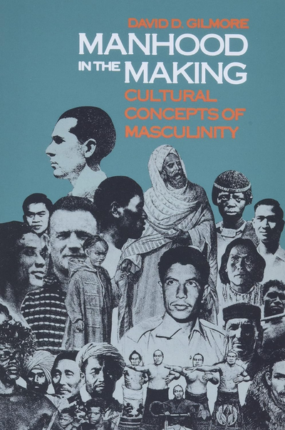
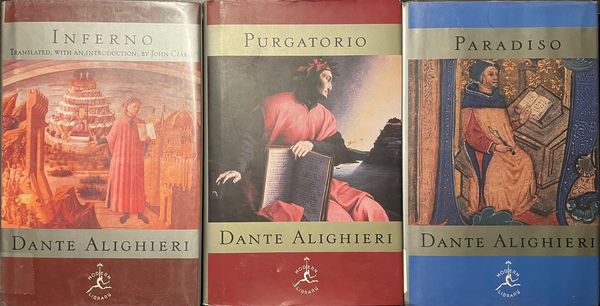

### Introducción

Dicen que puedes aprender mucho de un hombre en base a los libros que tiene en su estante...

A continuación presento una lista casi exhaustiva de los libros que tengo
físicamente organizados según la clasificación de la [Library of
Congress](https://www.loc.gov/catdir/cpso/lcco/). Dicho esto, no porque los
tenga significa que los haya leído, y no porque un libro no aparezca aquí
significa que no lo haya leído, pues francamente la mayoría de los libros los
he pirateado digitalmente. Aun así, los libros que decido adquirir físicamente
es porque tienen un lugar especial en mi corazón, especialmente aquellos
resaltados.

### B --- Filosofía, psicología, religión

- *Biblia "Dios Habla Hoy" (con Deuterocanónicos)*
- *Confesiones* --- San Agustín
- *Dios sí. Iglesia no. Respuestas fáciles a preguntas difíciles para jóvenes* --- Julio Muñoz López de Carrizosa, LC
- *Discurso del método y Meditaciones metafísicas* --- René Descartes
- *Imitación de Cristo* --- Tomás de Kempis
- *Manual del guerrero de la luz* --- Paulo Coelho
- *Moral Courage* --- Rushworth M. Kidder
- *Sobre el inconveniente de tener muchos amigos (y otros ensayos)* --- Plutarco

#### BF --- Psicología
- *Atomic Habits* --- James Clear
- *Deja de ser tú* --- Joe Dispenza
- *Flow: The Psychology of Optimal Experience* --- Mihaly Csikszentmihalyi
- *How to Win Friends & Influence People* --- Dale Carnegie
- *Iron John* --- Robert Bly
- *King, Warrior, Magician, Lover: Rediscovering the Archetype of the Mature Masculine* --- Robert Moore & Douglas Gillette
- *La inteligencia emocional* --- Daniel Goleman
- ***Manhood in the Making: Cultural Concepts of Masculinity* --- David D. Gilmore**
- *Skin in the Game: Hidden Asymmetries in Daily Life* --- Nassim Nicholas Taleb
- *The Six Pillars of Self-Esteem* --- Nathaniel Branden
- *What's Your Dream?* --- Simon Squibb

**

### C --- Ciencias de la historia
- *La rebelión de las masas* --- José Ortega y Gasset
- *Sapiens: De animales a dioses* --- Yuval Noah Harari

### F --- Historia de las Américas
- *Breve historia de México* --- José Vasconcelos
- *La raza cósmica* --- José Vasconcelos
- *The Myths of Mexico and Perú* --- Lewis Spence

### G --- Geografía, antropología, recreación
- *Can't Hurt Me* --- David Goggins
- *La era del vacío* --- Gilles Lipovetsky

### H --- Ciencias sociales
- *Don Eugenio Garza Sada* --- Gabriela Recio Cavazos
- *El Grupo Monterrey: Crónica de una dinastía empresarial* --- Abraham Nuncio
- *Nadie supo nada: La verdadera historia del asesinato de Eugenio Garza Sada* --- Jorge Fernández Menéndez

### J --- Ciencias políticas
- *El príncipe* --- Nicolás Maquiavelo

### P --- Lenguaje y literatura
- ***1984* --- George Orwell**
- *El alquimista* --- Paulo Coelho
- *El lobo estepario* --- Herman Hesse
- *Fahrenheit 451* --- Ray Bradbury
- ***Inferno* --- Dante Alighieri (traducción de John Ciardi)**
- *Los hermanos Karamazov* --- Fyodor Mikhaylovich Dostoyevskiy
- ***Purgatorio* --- Dante Alighieri (traducción de John Ciardi)**
- ***Paradiso* --- Dante Alighieri (traducción de John Ciardi)**

**

### Q --- Ciencias
- *Antifragile: Things That Gain From Disorder* --- Nassim Nicholas Taleb
- *Steve Jobs* --- Karen Blumenthal
- *The Black Swan: The Impact of the Highly Improbable* --- Nassim Nicholas Taleb

### R --- Medicina
- *Life at the Bottom: The Worldview that Makes the Underclass* --- Theodore Dalrymple

### U --- Ciencias militares
- *The Art of War* --- Sun Tzu

### Sin clasificar
- *Flor de Vainilla* --- Héctor Rivera
- *La Biblia de Jerusalén* --- Great Adventure Bible
- *Tu vida: tu mejor negocio* --- Salvador Alva
- *YOUCAT Latinoamérica*

